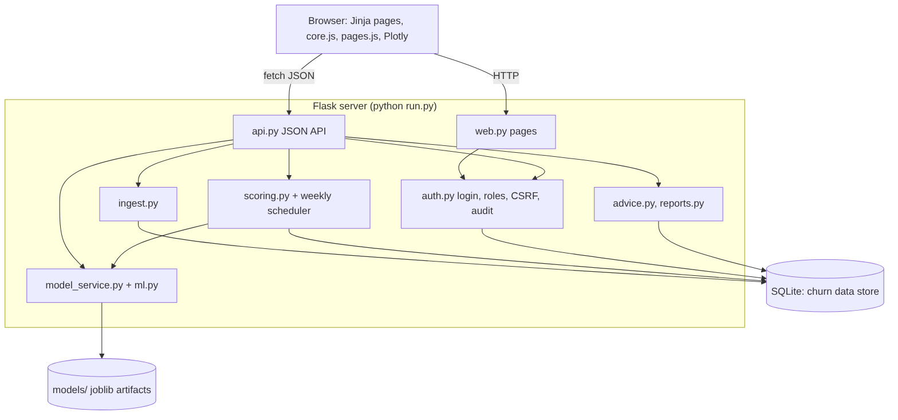

# BankChurn AI (Churn Detection Pro)

> A web application that predicts which bank customers are likely to leave, for relationship managers, retention managers, executives and administrators.

**Team:** Abdelhedi Elhamdi
**Course:** CS 488 — AI-First Software Engineering
**Status:** 🚧 In development

---

## What it does

An administrator loads customer data, the app engineers features and trains two models (Logistic Regression and LightGBM, with SMOTE and 5-fold cross-validation), compares them (Accuracy, Precision, Recall, F1, AUC, KS, ROC) and activates the best by AUC. Every active customer is then scored weekly and stored in a SQLite database. Users sign in with one of four roles and see a dashboard, per-customer reasons, alerts for high-risk customers, suggested retention actions (never sent automatically), and a monthly KPI report. Customer views and exports are audited and customer ids are masked.

## Tech stack

Python 3.12+, Flask, SQLite, pandas, scikit-learn, imbalanced-learn, LightGBM, Plotly.js. See `AI_CONTEXT.md`.

## Getting started

```bash
# 1. Clone and enter the repo
git clone <your-repo-url>
cd <repo>

# 2. One-time setup (installs git hooks)
./scripts/setup.sh

# 3. Environment file
cp .env.example .env

# 4. Install dependencies
python -m venv .venv && source .venv/bin/activate   # Windows: .venv\Scripts\activate
pip install -r requirements.txt

# 5. Data: an 8,000-customer sample is in data/ - click "Load sample data"
#    on the Data page, or upload your own CSV

# 6. Run the app, then open http://127.0.0.1:5000
python run.py

# 7. Tests
pytest
```

## Project structure

<!-- STRUCTURE:START (auto-generated by scripts/update-structure.sh — do not edit by hand) -->
```
.
.claude
.claude/skills
.cursor
.cursor/mcp.json
.cursor/rules
.cursor/skills
.cursorrules
.editorconfig
.env.example
.githooks
.githooks/pre-push
.github
.github/ISSUE_TEMPLATE
.github/copilot-instructions.md
.github/pull_request_template.md
.github/skills
.github/workflows
.gitignore
.mcp.json
.vscode
.vscode/extensions.json
.vscode/mcp.json
.vscode/settings.sample.json
AI_CONTEXT.md
CLAUDE.md
CONTRIBUTING.md
LICENSE
README.md
app
app/__init__.py
app/advice.py
app/api.py
app/auth.py
app/db.py
app/ingest.py
app/ml.py
app/model_service.py
app/reports.py
app/scoring.py
app/static
app/templates
app/web.py
data
data/.gitkeep
data/Bank Customer Churn Prediction.csv
docs
docs/CHANGELOG.md
docs/README.md
docs/ai-usage-log.md
docs/architecture.md
docs/crisp-dm.md
docs/decisions
docs/developer-guide.md
docs/ethics-and-ai-usage.md
docs/honesty-statement.md
docs/methodology-and-backlog.md
docs/openapi.yaml
docs/project-proposal.pdf
docs/refactor-and-optimization-report.md
docs/requirements-traceability.md
docs/setup-report.md
docs/setup.md
docs/uml
docs/user-guide.md
models
pytest.ini
requirements.txt
ruff.toml
run.py
scripts
scripts/check-docs.sh
scripts/setup.sh
scripts/update-structure.sh
tests
tests/__init__.py
tests/conftest.py
tests/test_app.py
tests/test_ml.py
```
<!-- STRUCTURE:END -->

## Documentation

- [Architecture](docs/architecture.md) — how the system is put together
- [Setup details](docs/setup.md) — full environment setup
- [Decisions (ADRs)](docs/decisions/) — why we chose what we chose
- [Changelog](docs/CHANGELOG.md) — what changed, when
- [Contributing / team workflow](CONTRIBUTING.md) — branches, commits, PRs
- [AI assistant context](AI_CONTEXT.md) — how our AI tools are configured

## Team workflow (short version)

1. Never push to `main`. Create a branch: `git checkout -b feat/short-name`.
2. Commit small, with clear messages.
3. Open a Pull Request; at least one teammate reviews before merge.
4. CI must be green before merging.

Full details in [CONTRIBUTING.md](CONTRIBUTING.md).


## Run it (Windows)
```
python -m venv .venv
.venv\Scripts\activate
pip install -r requirements.txt
python run.py
```
Open http://127.0.0.1:5000. Demo accounts: `admin`, `retention`, `executive`, `rm_france`, `rm_germany`, `rm_spain`. Password: `churn-demo-2026` (change it by setting `DEMO_PASSWORD` before the first run).
First use (as admin): Data & Upload → Load sample → Generate features → Train. Scoring then runs automatically.
Tests: `pytest`. Details: `docs/architecture.md`, `docs/requirements-traceability.md`.

## System diagram and documents


UML (PNG + Mermaid source) in `docs/uml/`: use-case, class, two sequence diagrams (predict, weekly scoring), component. API: `docs/openapi.yaml`. Also: `docs/user-guide.md`, `docs/methodology-and-backlog.md`, `docs/requirements-traceability.md`, `docs/refactor-and-optimization-report.md`, `docs/ethics-and-ai-usage.md`, `docs/ai-usage-log.md`, `docs/honesty-statement.md`, `docs/crisp-dm.md`, `docs/architecture.md`.
