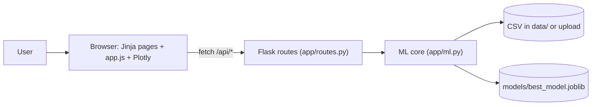
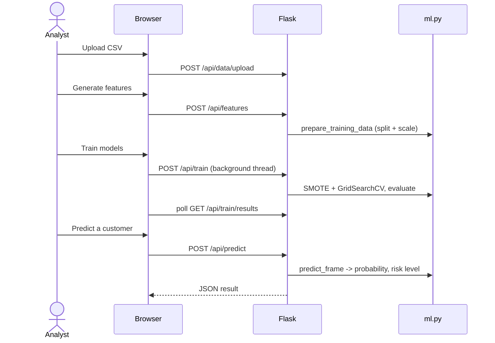

# Architecture

> Living document. Update it when the code drifts from it.
> _TODO (Hedi): replace/extend with the final Lab 5 diagrams if they differ._

## 1. Overview

Churn Detection Pro is a Flask web app. The browser loads server-rendered pages
(Home, Data, Features, Training, Prediction) and talks to a JSON API with
`fetch`. The API delegates all data/ML work to `app/ml.py`, which cleans the
data, engineers features, trains Logistic Regression and LightGBM, and scores
customers. State (loaded data, prepared split, models) lives in memory; the best
model is also saved to `models/` so predictions work after a restart.

## 2. Component diagram

## 3. Key modules

| Module | Responsibility | Lives in |
|--------|----------------|----------|
| App factory | Creates the Flask app, config | `app/__init__.py` |
| Routes | HTML pages + JSON API, in-memory state, training thread | `app/routes.py` |
| ML core | Cleaning, features, SMOTE + GridSearchCV training, metrics, scoring | `app/ml.py` |
| Templates | One Jinja page per step + `base.html` | `app/templates/` |
| Front end | Fetch calls, tables, Plotly charts | `app/static/js/app.js`, `css/style.css` |

## 4. Data model

One table of customers: `credit_score, country, gender, age, tenure, balance,
products_number, credit_card, active_member, estimated_salary` plus the target
`churn` (1 = left). Engineered features: `balance_salary_ratio, activity_score,
tenure_risk, age_risk, low_balance, high_value, credit_active`; gender is encoded
0/1 and country one-hot (France, Germany, Spain).

## 5. Key flows

## 6. The AI-assisted component

Inputs: the customer fields above. Output: churn probability, 0/1 prediction and
a risk level (Low <30%, Medium 30–60%, High ≥60%). The best of the two models by
ROC AUC is used. If no model is trained, prediction endpoints return HTTP 409 and
the UI asks the user to train first.

## 7. Known trade-offs / open questions

- In-memory, single-user state; not safe for concurrent users.
- Training runs in a background thread inside the web process (fine for a demo).
- Plotly.js comes from a CDN, so charts need internet access.
- The sample CSV is not in the repo (customer data); each teammate adds it to `data/`.
